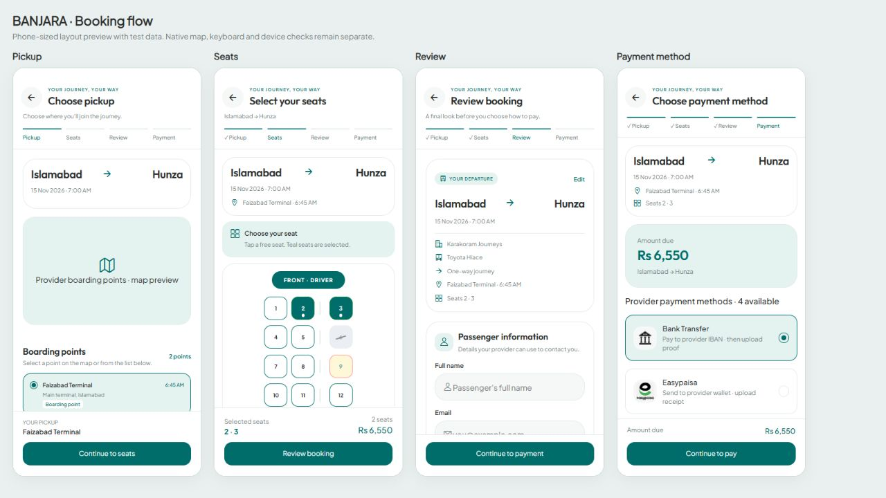
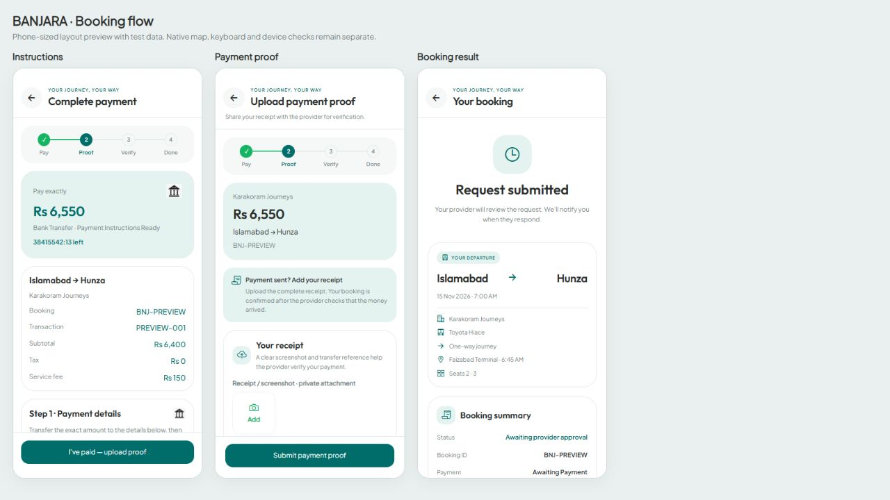

# Mobile Booking and Payment UI

This README documents the seven customer booking and payment screens rebuilt to match the app’s existing Home, Explore, and Trip Details styling.

The flow uses shared typography, teal actions, rounded cards, journey summaries, light and dark appearances, and consistent headers and bottom actions.

## Screens and source files

| Screen | Route file | Main UI implementation |
| --- | --- | --- |
| Choose pickup | [pickup/[id].tsx](<app/(customer)/pickup/[id].tsx>) | [ChoosePickupScreen.tsx](components/booking/ChoosePickupScreen.tsx) |
| Select your seats | [seat/[id].tsx](<app/(customer)/seat/[id].tsx>) | Route component and [SeatMap.tsx](components/seat/SeatMap.tsx) |
| Review booking | [booking/review.tsx](<app/(customer)/booking/review.tsx>) | [ReviewBookingScreen.tsx](components/booking/ReviewBookingScreen.tsx) |
| Choose payment method | [booking/payment.tsx](<app/(customer)/booking/payment.tsx>) | Route component |
| Complete payment | [payments/[paymentId].tsx](<app/(customer)/payments/[paymentId].tsx>) | Route component |
| Upload payment proof | [payments/proof/[paymentId].tsx](<app/(customer)/payments/proof/[paymentId].tsx>) | Route component |
| Booking result | [booking/success.tsx](<app/(customer)/booking/success.tsx>) | [BookingResultScreen.tsx](components/booking/BookingResultScreen.tsx) |

The pickup, review, and result route files re-export their feature components. The remaining route files contain the screen logic and presentation together.

## Booking flow

1. Open a published trip and choose a pickup point.
2. Select available seats.
3. Review the journey, pickup, seats, passenger information, and price breakdown.
4. Choose one of the provider’s available payment methods.
5. Continue to create the booking request. For a supported direct-transfer method with a payment transaction ID, open the payment instructions screen.
6. Transfer payment using the provider’s instructions, then upload the receipt and transaction reference.
7. Track provider approval and payment verification in the payment screen and My Bookings.

[p2pPaymentNav.ts](utils/p2pPaymentNav.ts) handles the handoff after booking creation. When the direct-transfer conditions are not met, it opens the booking result route. The result screen also has a **View my bookings** action.

A submitted request and a confirmed booking have different UI states. The result screen reads the current booking status instead of always showing a confirmation message.

## What each screen contains

### Choose pickup

- Booking progress at step 1 of 4.
- Compact route and departure summary.
- Existing pickup map with fullscreen controls.
- Published boarding points, their addresses, and boarding times when available.
- Selected pickup summary and **Continue to seats** action.
- Loading, empty, retry, and unavailable states.

The selected pickup must still exist in the current pickup list before continuing.

### Select your seats

- Booking progress at step 2 of 4.
- Compact journey and pickup summary.
- Driver/front indicator, seat grid, aisle, and seat-status legend.
- Selected seat numbers, total, and **Review booking** action.

Available seats can be selected. Booked and reserved seats stay disabled. Continuing requires a loaded seat map, selected seats, a trip and pickup, and no seat-loading error. Existing seat refresh and hold handling remain in the route.

### Review booking

- Booking progress at step 3 of 4.
- Full journey summary with an **Edit** action.
- Pickup and selected seats.
- Full name, email, and phone fields with appropriate keyboard/autofill settings.
- Price breakdown and booking-request explanation.
- Keyboard-aware layout and **Continue to payment** action.

Passenger edits remain in the booking store. The displayed pre-booking breakdown comes from that store; the booking/payment API response supplies the recorded amounts after submission.

### Choose payment method

- Booking progress at step 4 of 4.
- Compact journey summary and amount due.
- Provider payment methods with branded icons and selected states.
- Price breakdown and explanation of direct-to-provider payments.
- Bottom amount summary and **Continue to pay** action.

Methods come from [useProviderPaymentMethods.ts](hooks/useProviderPaymentMethods.ts), using the provider’s receiving accounts. Loading, errors, and missing receiving accounts have separate states.

### Complete payment

- Payment progress: Pay → Proof → Verify → Done.
- Amount, method, status, and payment-window countdown when supplied.
- Booking and transaction identifiers.
- Receiving-account selection and copyable transfer details.
- **I’ve paid — upload proof** action when appropriate.
- Existing correction, expiry, verification, refund, and payment-chat states.

### Upload payment proof

- Payment progress and transaction summary.
- Receipt/screenshot picker.
- Transaction reference, amount paid, and optional note.
- Upload/submission feedback and existing draft retention.
- Keyboard-aware form with a persistent **Submit payment proof** action.

The existing upload and proof-submission services remain responsible for sending the attachment and payment details.

### Booking result

- Status-specific icon, title, and explanation.
- Journey details when the selected trip matches the booking.
- Booking ID, approval status, payment status, and amount.
- My Bookings and Home actions.
- Hotel discovery for the selected destination when a current trip is available.

Without a current booking record, the screen shows an unavailable state instead of a success claim.

## Shared UI components

[BookingFlowPresentation.tsx](components/booking/BookingFlowPresentation.tsx) contains:

| Component/helper | Purpose |
| --- | --- |
| `withBookingFlow` | Wraps a screen in the shared travel design provider. |
| `useBookingColors` | Maps the existing travel palette to booking and payment colors. |
| `BookingFlowHeader` | Safe-area-aware back navigation, title, subtitle, and optional booking progress. |
| `BookingFlowSteps` | Pickup, Seats, Review, and Payment progress. |
| `BookingJourneyCard` | Route, departure, provider, vehicle, return details, pickup, and seats; supports compact mode. |
| `BookingFlowSection` | Rounded section card with heading, description, and optional icon. |
| `BookingFlowFooter` | Bottom action container with safe-area padding. |
| `BookingFlowNotice` | Shared explanatory and unavailable-state panel. |

The flow also reuses these feature components:

- [PickupCard](components/map/PickupCard.tsx) and [PickupMap](components/map/PickupMap.tsx).
- [Seat](components/seat/Seat.tsx) and [SeatMap](components/seat/SeatMap.tsx).
- [PriceCard](components/booking/PriceCard.tsx).
- [PaymentFlowSteps](components/payments/PaymentFlowSteps.tsx), [HowPaymentWorksNote](components/payments/HowPaymentWorksNote.tsx), and [PaymentChat](components/payments/PaymentChat.tsx).
- [Button](components/ui/Button.tsx), [Input](components/ui/Input.tsx), and [ImagePickerField](components/ui/ImagePickerField.tsx).

## Styling foundation

- **Headings:** Outfit.
- **Body and controls:** Plus Jakarta Sans.
- **Light appearance:** white background, soft neutral fields, teal actions, subtle borders.
- **Dark appearance:** dark travel surfaces, readable muted text, and mint/teal accents.
- **Layout:** rounded panels, compact summaries where selection controls need more room, and safe-area-aware actions.

Use [homeDesign.ts](constants/homeDesign.ts), [typography.ts](constants/typography.ts), and [TravelDesignProvider.tsx](components/ui/TravelDesignProvider.tsx) when extending these screens. Shared feature components use the travel palette inside the provider and retain their existing palette outside it.

## State and backend integration

- [bookingStore.ts](store/bookingStore.ts): trip, pickup, seats, passenger details, price breakdown, booking submission, and latest booking.
- [tripService.ts](services/tripService.ts): published pickup points and seat availability.
- [p2pPaymentService.ts](services/p2pPaymentService.ts): transaction details, receiving accounts, proof submission, and payment chat.
- [uploadService.ts](services/uploadService.ts): receipt attachment upload.
- [paymentProofDraftStore.ts](store/paymentProofDraftStore.ts): local receipt-form drafts.

When the backend is unavailable, the screen UI remains mounted while server-provided records are cleared or masked. Passenger input and receipt drafts remain local form data. Existing availability hooks and the root availability gate handle reconnect behavior.

## Layout previews

These previews use test data and HTML representations of native primitives. The map is a placeholder in the preview; the app uses its existing map component.





## Validation

Completed for this UI change:

- TypeScript check passed.
- 31 targeted tests passed, including checkout rendering/navigation, unavailable seats and methods, offline data masking, and booking-state behavior.
- Android Metro/Hermes bundle export passed.
- Phone-sized layout previews reviewed at 390 × 844 in light and dark appearances.

Run from the `Banjara` directory:

```powershell
npm run typecheck
node --test scripts/checkout-presentation.test.cjs scripts/backend-availability.test.cjs scripts/trip-details.test.cjs scripts/booking-presentation.test.cjs
npx expo export --platform android --output-dir ../.cleanup-backups/mobile-checkout-export
```

[checkout-presentation.test.cjs](scripts/checkout-presentation.test.cjs) uses the read-only [checkout render harness](scripts/helpers/checkout-render.cjs). Services and stores are mocked; these checks do not create live bookings, send payments, or upload receipts.

### Still to verify on a device

Android/iOS device testing remains pending for native map controls, keyboard behavior, font scaling, camera/gallery permissions, receipt selection, and the complete booking/payment flow in a test environment. A successful bundle export verifies compilation; it is not an installed-app or device test.
